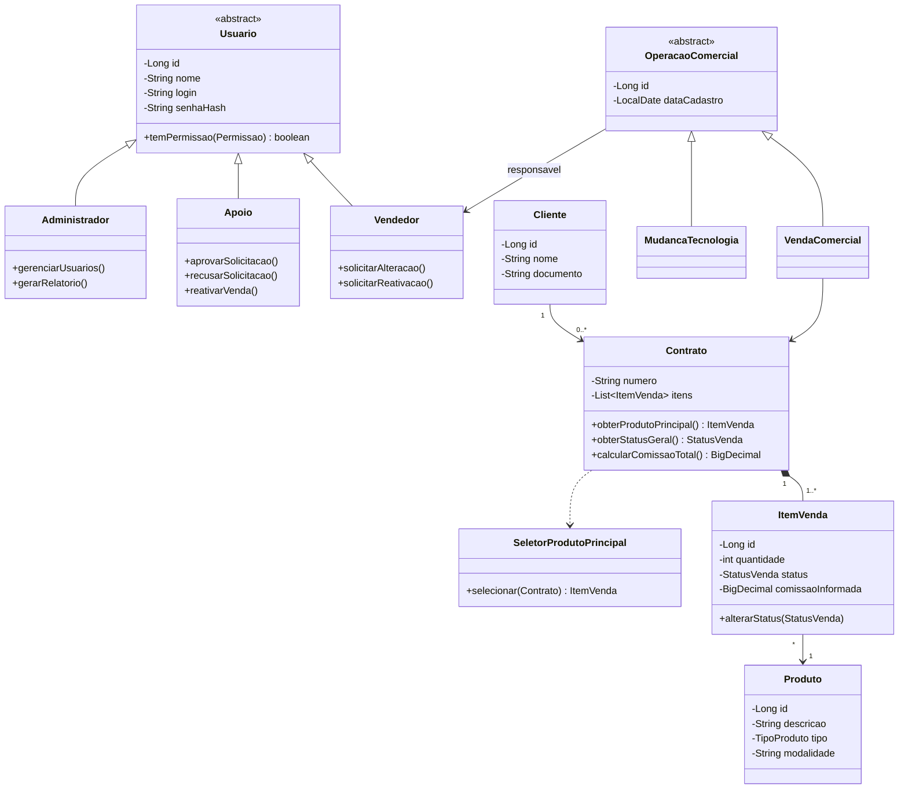
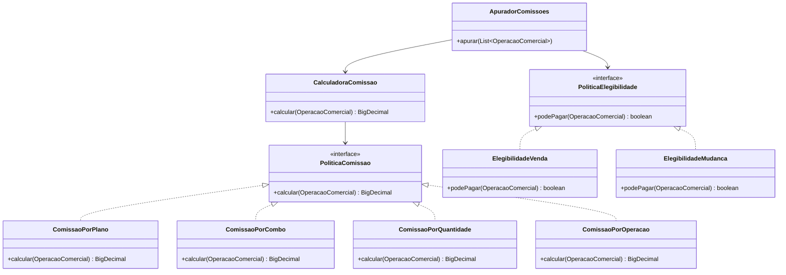
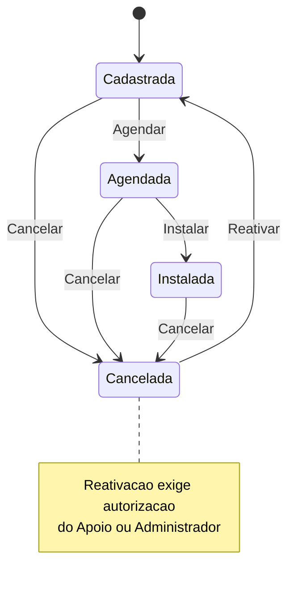
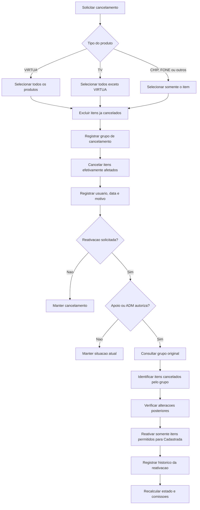
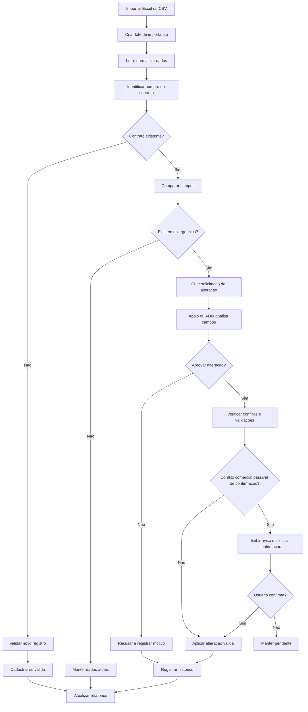
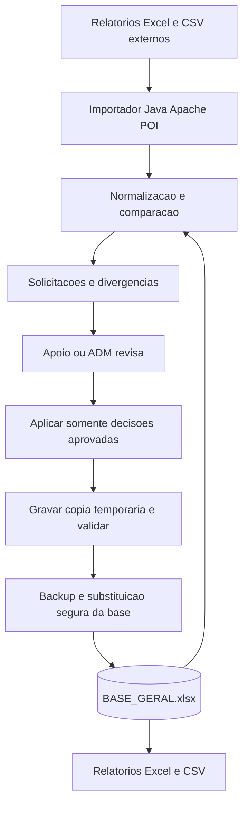
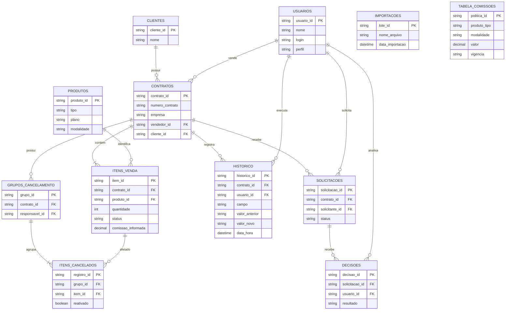
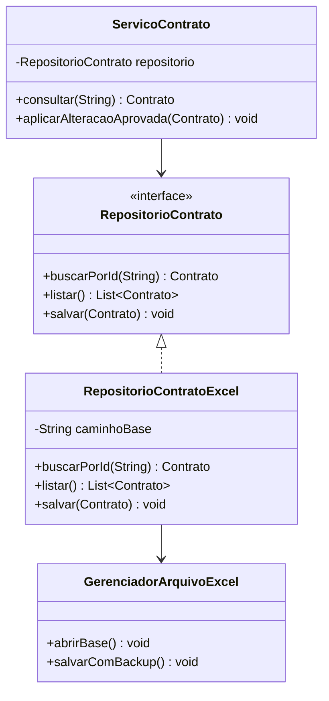

# Diagramas Mermaid — Sistema de Tratamento de Vendas e Comissões

**Projeto:** Linguagem de Programação II — Java  
**Objetivo:** documentação dos diagramas da versão inicial, com persistência EXCLUSIVAMENTE em planilhas Excel. SQLite fica para uma versão futura.  
**Como usar:** copie o conteúdo de cada bloco `mermaid` para https://mermaid.live/ ou visualize este Markdown em um editor compatível.

> **Atenção:** nesta primeira versão não haverá banco de dados. O arquivo `BASE_GERAL.xlsx` será a fonte persistente central. Estes são diagramas de **planejamento**. As classes, assinaturas, campos e relacionamentos ainda podem ser refinados na implementação. O fluxo de produtos secundários e estornos de comissões pagas requer detalhamento adicional.

## 1. Diagrama de classes — Estrutura principal

**O que representa:** as entidades centrais do negócio: usuários com perfis distintos, clientes, vendedores, contratos, produtos e itens de venda. Ilustra **herança, composição, associações e multiplicidade**. O produto principal é calculado pela prioridade **VIRTUA → TV → CHIP → FONE**.

## 2. Diagrama de classes — Políticas de comissão e elegibilidade

**O que representa:** dois comportamentos de **polimorfismo** por meio de interfaces: (a) cálculo de comissão por plano, combo, quantidade ou operação; (b) decisão de elegibilidade para pagamento. Venda comercial exige estado **Instalada**; Mudança de Tecnologia gera **R$ 5,00** desde **Cadastrada**, mas deixa de ser elegível ao cancelar.

**Exemplos comerciais:** VIRTUA e CHIP por plano/modalidade; FONE **R$ 35,00**; TV **R$ 89,00** isolada ou com CHIP, **R$ 119,00** com VIRTUA, **R$ 139,00** com VIRTUA e mais um produto; Wi-Fi Mesh **R$ 15,00 por unidade**. Algumas combinações de TV ainda precisam ser verificadas.

## 3. Diagrama de estados — Ciclo de vida da venda

**O que representa:** as transições da **RN04**. A sequência normal é **Cadastrada → Agendada → Instalada**. Qualquer etapa pode ir para **Cancelada**; uma reativação autorizada por Apoio/ADM retorna para **Cadastrada**.

## 4. Fluxograma — Cancelamento e reativação em cascata

**O que representa:** a **RN11**. Cancelar VIRTUA afeta todos os produtos; cancelar TV afeta todos, exceto VIRTUA; cancelar CHIP, FONE ou outro item é individual. Um **grupo de cancelamento** registra apenas os itens efetivamente alterados; na reativação, itens já cancelados antes permanecem cancelados.

## 5. Fluxograma — Importação e revisão de divergências

**O que representa:** como o sistema lê Excel/CSV, identifica contratos pelo número, compara com dados existentes e envia diferenças para **aprovação manual por campo**. Vendedor sugere; Apoio/ADM decide. Conflitos comerciais podem gerar aviso e confirmação explícita, sem dispensar validações obrigatórias.

## 6. Diagrama de persistência — Planilha principal (substitui SQLite)

**O que representa:** o sistema Java lê arquivos externos, compara com os registros da base central e salva somente alterações autorizadas em `BASE_GERAL.xlsx`. A base possui abas relacionadas por identificadores; não há banco de dados nesta versão.

## 7. Estrutura lógica das abas da BASE_GERAL.xlsx

**O que representa:** um mapa de chaves entre as abas, semelhante a um diagrama de entidades, mas implementado com planilhas e não com tabelas SQL.

**Observação:** a notação PK/FK serve apenas para documentar identificadores lógicos; o Excel não impõe essas restrições. O Java precisará validá-las. Recomenda-se guardar o número do contrato como texto, para preservar zeros iniciais, e separar `contrato_id` do número original quando a mesma numeração puder aparecer em mais de uma empresa.

## 8. Diagrama de classes — Armazenamento substituível

**O que representa:** interface de persistência e uma implementação Excel. No futuro, será possível adicionar SQLite sem reescrever as regras de negócio.

## Checklist para o grupo — Versão somente com planilhas

- [ ] Definir o formato de `BASE_GERAL.xlsx` e os cabeçalhos de cada aba.
- [ ] Definir IDs estáveis para contratos, itens, usuários e solicitações.
- [ ] Validar número de contrato e empresa sem perder zeros à esquerda.
- [ ] Criar leitura e gravação de Excel usando Apache POI.
- [ ] Criar rotina de cópia de segurança antes de salvar alterações.
- [ ] Gravar em arquivo temporário; conferir integridade antes de substituir a base.
- [ ] Impedir edições concorrentes: apenas uma gravação por vez.
- [ ] Importar Excel/CSV sem apagar os arquivos originais.
- [ ] Comparar registros e encaminhar diferenças para aprovação individual.
- [ ] Registrar histórico, decisões, cancelamentos e reativações em abas próprias.
- [ ] Testar importação repetida para evitar duplicação.
- [ ] Testar planilha bloqueada, corrompida, sem cabeçalhos e com linhas inválidas.
- [ ] Gerar relatórios e arquivo consolidado a partir da base principal.
- [ ] Manter possibilidade de futura implementação `RepositorioContratoSQLite`.
- [ ] Confirmar tratamento de produtos secundários e serviços adicionais isolados.
- [ ] Definir segurança dos dados e credenciais de usuários antes do uso real.

**Nota de escala:** uma aba `.xlsx` suporta até 1.048.576 linhas. Para bases muito grandes, particionar históricos por período ou migrar para banco de dados posteriormente. Não tratar o Excel como armazenamento multiusuário simultâneo: centralizar as escritas no aplicativo e utilizar bloqueio/serialização e backups.
