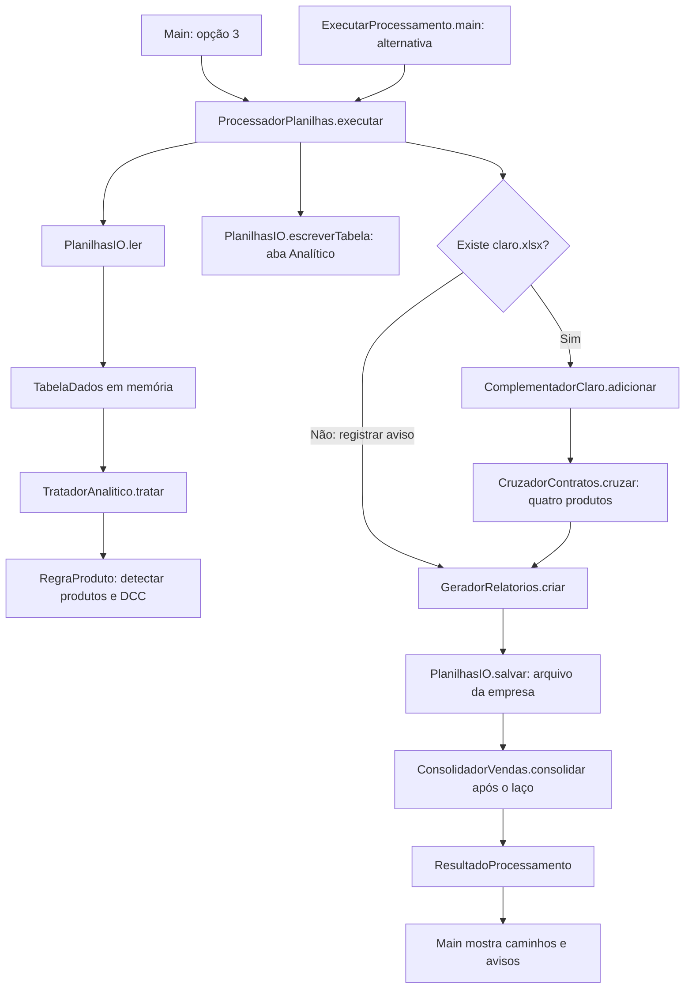

# Como funciona o processamento de planilhas

Guia de estudo e apresentação · Código conferido em **13/11/2026**.

Este guia explica o código existente em `src/main/java/lp2/processamento`. Foi preparado por leitura das classes, sem executar o processamento nesta revisão. Leia primeiro o fluxo, depois os conceitos de Java e, por fim, ensaie o roteiro.

## 1. O que o módulo faz

Ele recebe arquivos de vendas de telecomunicações, identifica produtos, acrescenta indicadores, compara contratos com uma base complementar, cria resumos e salva novos arquivos Excel. No final, reúne os analíticos gerados em `vendas.xlsx`.

É uma sequência de **entrada → transformação → saída**. Os relatórios trabalham com os dados importados; o módulo não implementa login, aprovação manual, cálculo por política de comissão ou cadastro das entidades do futuro sistema comercial.

| Local | Utilização |
|---|---|
| `dados/importacao/` | Entradas `.xls`, `.xlsx` e `.csv`, diretamente nessa pasta. Não procura entradas em subpastas. |
| `dados/importacao/analitico_da_claro/claro.xlsx` | Base complementar opcional, com abas de produtos. |
| `dados/exportacao/arquivos_para_processar/saida/` | Analíticos por empresa, com nomes como `VNA - ANALITICO dd.MM.xlsx`. |
| `dados/exportacao/vendas.xlsx` | União dos analíticos gerados com sucesso na execução. |

> **Antes de demonstrar:** o Java apaga todos os arquivos regulares da pasta de saída ao começar, mesmo que não encontre entradas. Não apaga subpastas. Use amostras fictícias em uma cópia isolada do projeto.

## 2. O que chama o quê



O diagrama resume as fases. No código, quem chama as operações principais é `ProcessadorPlanilhas`; o tratador chama as regras e o complementador também usa `PlanilhasIO`.

### Ponto de entrada pelo menu

Em [Main.java](../../src/main/java/Main.java), o `case "3"` executa:

```java
ResultadoProcessamento resultado =
    new ProcessadorPlanilhas(Path.of(".")).executar();
```

Leia da esquerda para a direita em duas etapas:

1. `new ProcessadorPlanilhas(...)` cria o objeto e executa seu construtor. `Path.of(".")` representa o diretório de trabalho atual; execute a partir da raiz do projeto.
2. `.executar()` chama o método que coordena o fluxo e devolve um `ResultadoProcessamento`, guardado na variável `resultado`.

O `Main` consulta esse resultado para mostrar os arquivos, o consolidado e os avisos. O objeto `Vendedor` criado antes do menu é uma demonstração separada: ele não autoriza nem participa do processamento atual.

Existe outra entrada em `ExecutarProcessamento.main`. Ela chama o mesmo processador, aceitando a raiz como argumento; não é outro processamento nem uma fase executada pelo menu.

## 3. Sequência detalhada

### 3.1. Preparar caminhos e localizar entradas

O construtor do processador cria `ConfiguracaoProcessamento`, que calcula os caminhos a partir da raiz recebida. Ele também possui objetos de tratamento, complementação, cruzamento e relatórios.

Ao chamar `executar()`:

1. Cria as pastas necessárias, se não existirem.
2. Limpa os arquivos regulares da pasta de saída.
3. Lista arquivos diretamente na entrada, seleciona as três extensões aceitas e ordena por caminho.
4. Se não houver entrada, retorna lista vazia, consolidado `null` e um aviso.
5. Para cada entrada, executa as fases seguintes.

O nome define a empresa: se contiver `VNA`, ignorando maiúsculas/minúsculas, é VNA; qualquer outro nome é tratado como RDT. Não há reconhecimento genérico de empresas.

### 3.2. Ler o arquivo com `PlanilhasIO`

A chamada é `PlanilhasIO.ler(entrada, "Analítico")`.

- Para Excel, `WorkbookFactory.create` abre XLS/XLSX. Procura a aba `Analítico`; se não a encontrar, usa a primeira.
- Para CSV, lê UTF-8 e escolhe vírgula ou ponto e vírgula comparando suas contagens na primeira linha. Essa detecção é simples.
- A primeira linha é o cabeçalho. No Excel, linhas completamente vazias são ignoradas.
- Valores são convertidos para representações Java: texto, número, booleano ou data. Fórmulas são lidas pelo resultado em cache; o código não as recalcula nessa leitura.

O retorno é uma `TabelaDados`, não um arquivo aberto. Os recursos de leitura são fechados pelo `try` com recursos.

### 3.3. Guardar os dados em `TabelaDados`

Pense nela como uma planilha temporária na memória:

```java
List<String> colunas;
List<Map<String, Object>> linhas;
```

`List` é uma sequência; `Map` associa uma chave a um valor. Cada linha é um mapa em que a chave é o nome da coluna:

```text
"Contrato"       → "100"
"Produtos"       → "VIRTUA + TV"
"FormaPagamento" → "DÉBITO"
```

`Object` permite valores de tipos diferentes. `linha.get("Produtos")` lê uma célula pelo cabeçalho; `linha.put("TV", 1)` escreve um valor naquela linha.

A classe oferece inclusão/remoção de colunas, cópia de linhas, seleção de colunas e conversões. `numero` interpreta formatos numéricos, inclusive exemplos como `1.234,56`. Texto inválido pode terminar como zero; o módulo não produz erro por célula nesse caso.

### 3.4. Tratar o analítico

`TratadorAnalitico.tratar(tabela, nomeArquivo)` altera a tabela recebida e devolve essa mesma referência.

1. Exige os cabeçalhos `Produtos` e `Contrato`; a ausência gera `ProcessamentoException`.
2. Remove `IdVenda`, `IdCliente`, `Proposta`, `TipoCliente`, `IdVendedor`, `TipoPacote` e `ComTV`.
3. Acrescenta, se ainda não existirem, `VIRTUA`, `CHIP`, `PORT`, `TV`, `FONE`, `DCC` e `SOMA`. Tenta posicioná-las após `Supervisor`.
4. Acrescenta `Empresa`, se necessário.
5. Percorre as linhas e executa as regras de produto.
6. Define `PORT = 0`, pois exige revisão manual.
7. Soma os seis indicadores na memória.
8. Define `Empresa = PE` quando o supervisor é `ZAIRO JUNIOR` ou `EDVALDO SANTOS`; nos demais casos usa a empresa do nome do arquivo.

Os nomes de cabeçalhos são relevantes: `Produtos` e `produtos` não são automaticamente equivalentes.

### 3.5. Executar as regras de produto

O tratador possui uma `List<RegraProduto>` com estas instâncias, nesta ordem:

```java
new RegraPresencaProduto("VIRTUA")
new RegraPresencaProduto("CHIP")
new RegraPresencaProduto("TV")
new RegraPresencaProduto("FONE")
new RegraDcc()
```

São cinco objetos, mas apenas **duas classes concretas de regra**. Quatro objetos reutilizam a mesma classe com parâmetros diferentes.

`RegraPresencaProduto` procura o nome do produto dentro de `Produtos`, sem distinguir maiúsculas/minúsculas, e retorna 1 ou 0. É busca textual por trecho, não uma interpretação completa do pacote comercial.

`RegraDcc` retorna 1 se `VIRTUA` já for 1 e o pagamento contiver `DEBITO`, após retirar acentos e converter para maiúsculas. Por isso a ordem importa: VIRTUA é calculado antes de DCC.

### 3.6. Criar o arquivo Excel em memória

O processador cria `new XSSFWorkbook()` e chama:

```java
PlanilhasIO.escreverTabela(wb, "Analítico", tabela, true);
```

`wb` representa a pasta de trabalho Excel em memória. Ainda não foi salvo no disco.

A escrita cria cabeçalho formatado, congela a primeira linha, aplica filtro quando há dados, ajusta larguras e formata datas. O argumento `true` manda escrever `SOMA` como fórmula `SUM(...)` com referências aos indicadores daquela linha.

Assim, há dois usos: o valor calculado em memória alimenta os resumos, e a fórmula aparece no Excel. `SOMA` inclui DCC e PORT; não representa necessariamente quantidade de vendas ou de produtos físicos.

### 3.7. Acrescentar a base Claro

Se `claro.xlsx` existir, `ComplementadorClaro.adicionar` lê suas abas e considera apenas as reconhecidas:

| Aba | Colunas selecionadas | Tratamento |
|---|---|---|
| `virtua` | `NM_INDICADOR_NEGOCIO`, `NR_CONTRATO`, `NM_PARCEIRO` | Exclui desistência, venda bruta e parceiro da outra empresa. |
| `tv` | `NM_INDICADOR_NEGOCIO`, `NM_PARCEIRO`, `DT` | Mesmos filtros de indicador e parceiro. |
| `chip` | `DT_ATIVACAO`, `CD_COMTA`, `CONTRATO_NET` | Normaliza contrato e exclui código de conta conforme a empresa. |
| `tel fixo` | `NM_INDICADOR_NEGOCIO`, `NM_PARCEIRO`, `NR_CONTRATO` | Mesmos filtros de indicador e parceiro. |

Para saída RDT, exclui parceiro `VNA TELECOM LTDA ME`; para VNA, exclui `RDT TELECOM LTDA`. No CHIP, exclui `CD_COMTA = 4ZEJ` para RDT e `3Z67` para VNA.

`NormalizadorContrato.normalizar` remove o sufixo artificial `.0` de um identificador numérico textual e preserva zeros à esquerda quando já estão no texto. `normalizarChip` também tenta retirar os prefixos `9700`, `136`, `9500` e `63700`, nessa sequência. Zeros que eram apenas formatação de uma célula numérica não fazem parte do valor numérico.

As abas filtradas são copiadas para o novo arquivo; a base original não é salva por essa operação. Colunas selecionadas ausentes ficam com valores nulos, portanto a seleção não equivale a uma validação completa de esquema.

Sem `claro.xlsx`, registra aviso e continua com o analítico e os relatórios, sem cruzamentos.

### 3.8. Cruzar os contratos

O processador chama `CruzadorContratos.cruzar` quatro vezes:

| Indicador no analítico | Aba complementar | Coluna de contrato | Coluna acrescentada |
|---|---|---|---|
| `VIRTUA` | `virtua` | `NR_CONTRATO` | `virtua_analitico` |
| `TV` | `tv` | `DT` | `tv_analitico` |
| `CHIP` | `chip` | `CONTRATO_NET` | `chip_analitico` |
| `FONE` | `tel fixo` | `NR_CONTRATO` | `fone_analitico` |

Para cada produto, seleciona contratos do analítico cujo indicador é 1 e compara com os contratos da aba complementar, após normalização.

- **Nas duas fontes:** preenche a coluna acrescentada com o contrato correspondente.
- **Somente na base complementar:** colore a fonte do contrato original de vermelho.
- **Somente no analítico:** acrescenta uma linha ao final da aba complementar com contrato em verde.

Também cria a coluna `olhar`, com uma lista compacta das divergências e suas cores. Essa lista é independente da posição dos registros originais; não deve ser interpretada como uma observação vinculada à mesma linha da base.

Usa `Set` para comparar identificadores únicos e evitar repetição na comparação; isso não remove automaticamente linhas duplicadas do analítico. Se a aba ou coluna esperada não existir, imprime aviso e abandona aquele cruzamento. Esses avisos de console não são todos incorporados ao resultado final.

### 3.9. Gerar relatórios

`GeradorRelatorios.criar` chama dois métodos privados:

| Método | Aba gerada | Funcionamento |
|---|---|---|
| `resumoSupervisorVendedor` | `Planilha1` | Agrupa por supervisor + vendedor, soma `VIRTUA`, `CHIP`, `PORT`, `TV`, `SOMA` e `Valor`; ordena pela soma de `Valor`, decrescente. |
| `resumoVendedorData` | `Planilha2` | Agrupa por vendedor e data de instalação; conta linhas com `Produtos` preenchido e calcula o total. Campos vazios aparecem como `(blank)`. |

Esses relatórios usam a tabela analítica tratada, não uma nova tabela resultante do cruzamento. São **resumos estáticos**, não tabelas dinâmicas nativas do Excel. O campo `Valor` é somado como veio da origem; isso não implementa cálculo de comissão por política.

### 3.10. Salvar e consolidar

`PlanilhasIO.salvar` escreve primeiro em arquivo temporário na pasta de destino e tenta movê-lo atomicamente para o nome final. Se a movimentação atômica não for suportada, tenta substituição comum. O temporário é removido no `finally`. Isso reduz riscos de escrita incompleta, mas não cria histórico ou backup.

Cada saída usa empresa + data `dd.MM`. Duas entradas da mesma empresa apontam para o mesmo arquivo: a última gravação bem-sucedida na ordem das entradas prevalece. Um `LinkedHashSet<Path>` mantém apenas um caminho para essa saída na consolidação.

Após o laço, `ConsolidadorVendas.consolidar`:

1. Relê somente a aba `Analítico` de cada caminho gerado.
2. Reúne as colunas e acrescenta as linhas, sem deduplicar vendas.
3. Salva `dados/exportacao/vendas.xlsx` com uma aba `Analítico` e fórmula de soma.

O consolidado não copia os relatórios nem as abas complementares. Se não houver arquivos gerados, retorna `null`; um `vendas.xlsx` antigo não é automaticamente removido e não comprova sucesso da execução atual.

## 4. Exemplo para acompanhar os dados

Exemplo conceitual, não executado nesta revisão. Suponha uma entrada `VNA_EXEMPLO.xlsx`:

| Contrato | Produtos | FormaPagamento | Supervisor | Vendedor |
|---|---|---|---|---|
| 100 | VIRTUA + TV | DÉBITO | Ana | João |

Após o tratamento:

| Empresa | VIRTUA | CHIP | PORT | TV | FONE | DCC | SOMA |
|---|---|---|---|---|---|---|---|
| VNA | 1 | 0 | 0 | 1 | 0 | 1 | 3 |

VIRTUA e TV foram encontrados no texto; DCC vale 1 pelo VIRTUA com débito. A soma é 3 porque inclui o indicador DCC.

Para o cruzamento de VIRTUA, suponha contratos `{100, 200}` na base complementar e `{100}` no analítico: 100 aparece nas duas fontes; 200 recebe fonte vermelha e entra em `olhar`. Se o analítico também tivesse 300 com VIRTUA = 1, seria acrescentado em verde à aba complementar de saída.

O relatório soma os indicadores da linha de João. Depois, o analítico VNA gerado entra no consolidado.

## 5. Classes, interfaces e conceitos de orientação a objetos

### Classe, objeto, construtor e método

**Classe** é a definição de dados e comportamentos. **Objeto** é uma instância dessa definição. `ProcessadorPlanilhas` é classe; `new ProcessadorPlanilhas(...)` cria um objeto.

**Construtor** inicializa o objeto e tem o nome da classe, sem tipo de retorno. No processador, recebe a raiz e cria a configuração. **Método** é uma operação: `executar`, `tratar`, `cruzar` e `salvar` são exemplos.

### Interface: `RegraProduto`

```java
public interface RegraProduto {
    String coluna();
    int detectar(Map<String, Object> linha);
}
```

Uma interface define um contrato de comportamento. Neste caso, exige que uma regra informe sua coluna e consiga detectar seu indicador. Os métodos acima são públicos e abstratos implicitamente, mesmo sem essas palavras escritas.

Não se faz `new RegraProduto()`. Criam-se objetos de classes concretas que implementam a interface:

```java
public final class RegraDcc implements RegraProduto
```

`implements` significa que a classe cumpre o contrato. `@Override` indica que o método implementa ou sobrescreve um método previsto em um tipo superior. Interfaces também podem ter métodos `default` e estáticos em Java, mas esta interface não os usa.

### Polimorfismo: a mesma chamada, comportamentos diferentes

O ponto central está no laço de `TratadorAnalitico`:

```java
for (RegraProduto regra : regras) {
    linha.put(regra.coluna(), regra.detectar(linha));
}
```

A variável tem tipo `RegraProduto`, mas pode apontar para `RegraPresencaProduto` ou `RegraDcc`. A chamada `detectar(linha)` executa o método da classe real do objeto: uma busca texto, a outra verifica VIRTUA e pagamento.

Isso é polimorfismo. O tratador trabalha com o contrato comum e não precisa de um `if` para escolher a classe da regra. Esse exemplo é real no processamento; sua aceitação na contagem acadêmica deve seguir os critérios da atividade.

### Classe abstrata: `Usuario`, fora do processamento

**Nenhuma classe própria deste pacote de processamento é abstrata.** O exemplo do projeto está em `Usuario.java`:

```java
public abstract class Usuario {
    // Campos, construtor e métodos concretos existem no arquivo.
    public abstract boolean podeAprovarAlteracoes();
    public abstract boolean podeGerenciarUsuarios();
}
```

Uma classe abstrata não pode ser instanciada diretamente. Pode guardar estado, ter construtor e métodos prontos, além de exigir métodos abstratos das subclasses.

`Vendedor extends Usuario` herda dados e comportamentos comuns e implementa as permissões exigidas. `extends` expressa herança de classe; `implements` expressa implementação de interface.

| Aspecto | Interface `RegraProduto` | Classe abstrata `Usuario` |
|---|---|---|
| Papel no projeto | Contrato das regras de detecção | Base comum dos usuários |
| Estado por objeto | Não declara campos de instância | Possui ID, nome, login e outros campos |
| Construtor | Não tem construtor de instância | Tem construtor usado pelas subclasses |
| Relação | `RegraDcc implements RegraProduto` | `Vendedor extends Usuario` |
| Instanciação direta | Não | Não |

### Composição e delegação

`ProcessadorPlanilhas` **tem um** `TratadorAnalitico`, um `CruzadorContratos` e outros colaboradores. Ele não herda dessas classes: mantém referências e delega tarefas a elas. Isso organiza o fluxo sem colocar toda a implementação no `Main`.

Pode ser descrito como uma **fachada**: oferece a entrada simples `executar()` para um trabalho composto de várias etapas. As regras plugáveis seguem a ideia de **estratégias**: comportamentos diferentes acessados por um contrato comum.

### Encapsulamento, `private`, `final` e `static`

- `private` restringe acesso ao interior da classe. Os métodos privados de relatório são detalhes internos chamados por `criar`.
- `final class` impede criar subclasses daquela classe. Não significa classe abstrata; é uma restrição diferente.
- `final` em uma referência impede substituí-la por outra após inicializada, mas não impede alterar o conteúdo do objeto referenciado.
- `static` pertence à classe: chama-se `PlanilhasIO.ler(...)`, sem `new PlanilhasIO()`. O construtor privado evita sua instanciação externa.
- `ResultadoProcessamento` usa campos privados/finais e `List.copyOf`, evitando que o chamador modifique suas listas retornadas.

Há um limite de encapsulamento em `TabelaDados`: `colunas()` oferece uma visão não modificável, mas `linhas()` devolve a lista mutável usada pelo tratamento. Portanto, não diga que toda a tabela é imutável.

### Interfaces das bibliotecas

Em `Workbook wb = new XSSFWorkbook()`, `Workbook` é uma interface do Apache POI e `XSSFWorkbook` é a implementação concreta para XLSX. `Sheet`, `Row` e `Cell` representam aba, linha e célula nessa biblioteca.

`List`, `Map` e `Set` também são interfaces, da biblioteca Java. `ArrayList`, `LinkedHashMap` e `HashSet` são exemplos de implementações. Não são classes criadas pelo grupo.

`List<String>` significa lista de textos; `Map<String, Object>` significa mapa com chaves de texto e valores de diferentes tipos. Esses parâmetros de tipo são chamados de generics.

### Lambdas, referências de método e streams

```java
arquivos.filter(Files::isRegularFile).sorted().toList();
```

O stream percorre os caminhos; `filter` mantém arquivos regulares, `sorted` ordena e `toList` reúne o resultado. `Files::isRegularFile` é uma referência de método: fornece uma operação a ser chamada para cada elemento.

```java
filtrada.linhas().removeIf(l -> /* condição */);
```

`l -> ...` é uma lambda: uma função curta passada ao método. `removeIf` remove as linhas cuja condição for verdadeira. Não é declaração de uma nova classe de domínio.

## 6. Como os erros são tratados

`ProcessamentoException extends RuntimeException` é uma exceção personalizada. Usa herança, mas isso não a transforma em classe abstrata nem em política comercial.

| Situação | Comportamento atual |
|---|---|
| Entrada sem `Produtos` ou `Contrato` | Lança `ProcessamentoException`; o laço captura a falha daquele arquivo e registra aviso. |
| Falha dentro do processamento de uma entrada | `catch (Exception e)` registra aviso e tenta a próxima entrada. |
| Base Claro ausente | Continua sem cruzamento e acrescenta aviso ao resultado. |
| Aba/coluna ausente no cruzamento | Imprime aviso no console e retorna daquele cruzamento. |
| Falha de I/O na preparação, limpeza ou consolidação | O bloco externo lança `ProcessamentoException` com a causa original. |

O `Main` atual não captura essa exceção final em torno de `executar()`; ela pode encerrar a aplicação. Portanto, nem toda falha se transforma em aviso recuperável.

`try (Workbook wb = ...)` é **try-with-resources**: fecha o recurso automaticamente, inclusive em caso de erro. `finally` executa a limpeza prevista, como remover o arquivo temporário.

## 7. Mapa dos arquivos para estudar

Todos os nomes abaixo estão em `src/main/java/lp2/processamento/`.

| Arquivo | Pergunta que ajuda a responder |
|---|---|
| [ProcessadorPlanilhas.java](../../src/main/java/lp2/processamento/ProcessadorPlanilhas.java) | Quem coordena e em que ordem? |
| [ConfiguracaoProcessamento.java](../../src/main/java/lp2/processamento/ConfiguracaoProcessamento.java) | De onde vêm os caminhos? |
| [PlanilhasIO.java](../../src/main/java/lp2/processamento/PlanilhasIO.java) | Como lê, escreve e salva arquivos? |
| [TabelaDados.java](../../src/main/java/lp2/processamento/TabelaDados.java) | Como os dados ficam na memória? |
| [TratadorAnalitico.java](../../src/main/java/lp2/processamento/TratadorAnalitico.java) | Quais transformações acontecem nas linhas? |
| [RegraProduto.java](../../src/main/java/lp2/processamento/RegraProduto.java) | Qual é o contrato comum? |
| [RegraPresencaProduto.java](../../src/main/java/lp2/processamento/RegraPresencaProduto.java) | Como detecta um produto no texto? |
| [RegraDcc.java](../../src/main/java/lp2/processamento/RegraDcc.java) | Como detecta débito com VIRTUA? |
| [ComplementadorClaro.java](../../src/main/java/lp2/processamento/ComplementadorClaro.java) | Como filtra e copia a base complementar? |
| [NormalizadorContrato.java](../../src/main/java/lp2/processamento/NormalizadorContrato.java) | Como padroniza os contratos antes de comparar? |
| [CruzadorContratos.java](../../src/main/java/lp2/processamento/CruzadorContratos.java) | O que significam vermelho, verde e `olhar`? |
| [GeradorRelatorios.java](../../src/main/java/lp2/processamento/GeradorRelatorios.java) | Como produz os dois resumos? |
| [ConsolidadorVendas.java](../../src/main/java/lp2/processamento/ConsolidadorVendas.java) | O que entra no `vendas.xlsx`? |
| [ResultadoProcessamento.java](../../src/main/java/lp2/processamento/ResultadoProcessamento.java) | O que volta para o menu? |
| [ProcessamentoException.java](../../src/main/java/lp2/processamento/ProcessamentoException.java) | Qual é a exceção própria? |
| [ExecutarProcessamento.java](../../src/main/java/lp2/processamento/ExecutarProcessamento.java) | Como iniciar sem passar pelo menu? |

## 8. Roteiro para explicar na apresentação

1. **Entrada:** “A opção 3 do Main cria o processador e chama executar. A configuração resolve os caminhos a partir da raiz.”
2. **Leitura:** “PlanilhasIO lê Excel ou CSV e transforma em TabelaDados, uma estrutura de colunas e mapas de valores na memória.”
3. **Tratamento:** “TratadorAnalitico valida cabeçalhos, remove colunas e executa regras para gerar os indicadores.”
4. **POO:** “RegraProduto é uma interface. RegraPresencaProduto e RegraDcc a implementam. O tratador chama detectar pela interface e cada objeto executa sua implementação: esse é o polimorfismo.”
5. **Comparação:** “Se houver a base Claro, o complementador filtra suas abas e o cruzador identifica contratos em comum ou exclusivos. Vermelho significa só na base complementar; verde, só no analítico.”
6. **Saída:** “O gerador produz dois resumos, PlanilhasIO salva cada arquivo e o consolidador reúne apenas as abas Analítico em vendas.xlsx.”
7. **Retorno:** “O resultado devolve caminhos e avisos ao Main. O processamento tem tratamento por arquivo, mas falhas externas podem propagar exceção.”
8. **Limites:** “Esse módulo não tem classe abstrata própria. Usuario é um exemplo abstrato em outra parte do projeto. Também não há aprovação manual ou autenticação funcional neste fluxo.”

Para ensaiar, abra os arquivos na ordem do roteiro e acompanhe a linha fictícia do exemplo. Explique primeiro a finalidade da operação e depois mostre a chamada correspondente no código.
